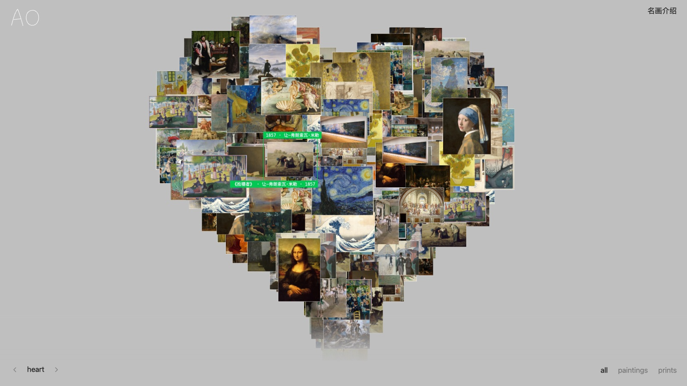

<div align="center">

# artorb

**世界名画的立体漫游**

一座可以转动的名画馆：56 幅公版名画浮在三维空间里，拖动、靠近、点开，读一段中文介绍。

[**在线体验 → art.mistwu.com**](https://art.mistwu.com) · [图片来源](https://art.mistwu.com/credits) · [备用地址](https://artorb.pages.dev)


<a href="https://art.mistwu.com"></a>

</div>

## 特点

- 🌐 **五种形状**：sphere / heart / smiley / star / grid，底部箭头或方向键切换。
- 🖱️ **自由操作**：拖动旋转，滚轮或双指缩放，悬停看标注，点击进入作品详情。
- 🖼️ **按需加载**：420px 预览图作三维纹理，点开时才加载 960px 大图。
- 📖 **中文介绍**：8 段原创短文，手机上也能完整阅读。
- 🔒 **零依赖外部**：没有账号、没有后端、没有第三方请求，图片全部本地托管。

> 场景里有 307 张卡片，去重后是 56 幅作品（paintings 53 + prints 3），界面计数显示的是实际作品数。

## 图片来源与许可

全部 56 幅画来自 [Wikimedia Commons](https://commons.wikimedia.org/)。逐一查看文件 API 返回的 `extmetadata`，只收录同时满足以下两项的文件：

```text
Copyrighted:      False
LicenseShortName: Public domain
```

现代作品、来源不明或不满足上述条件的文件一律跳过。每幅画的原图、Commons 说明页、作者、年份和许可记录在：

| 位置 | 内容 |
| --- | --- |
| [`data/artworks.json`](data/artworks.json) | 来源与许可清单 |
| `data/commons-cache/license-*.json` | 许可查询的原始响应 |
| [art.mistwu.com/credits](https://art.mistwu.com/credits) | 线上来源页 |

作品介绍为本站原创。公版状态因法域而异，二次使用前请查看对应的文件说明页。

## 本地开发

需要 Node.js 22.18 或更高版本（脚本直接用 Node 运行 TypeScript）。

```sh
npm install
npm run dev          # 开发服务器：http://localhost:8797
```

常用命令：

| 命令 | 作用 |
| --- | --- |
| `npm run build` | 打包到 `dist/`，并把首屏预渲染进 `dist/index.html` |
| `npm run preview` | 在 <http://localhost:8799> 预览 `dist/` |
| `npm run typecheck` | TypeScript 类型检查 |
| `npm test` | 运行 Vitest 测试 |
| `npm run check` | 依次运行类型检查、测试和打包 |

页面由 React、three.js 和 motion 组成，用 Vite 打包，样式用 Tailwind CSS v4。

three.js 固定在 0.185.1，motion 固定在 12.35.1（`package.json` 的 `overrides` 同时固定 framer-motion、motion-dom 和 motion-utils）。motion 12.35.2 起改用解析法计算弹簧速度，动画收尾会提前一帧。升级前先确认能接受这个变化。

### 更新画作

画作数据只在 `data/` 里维护，卡片列表、来源页、`artworks.json`、`robots.txt` 和 `sitemap.xml` 都在打包时生成。

```sh
npm run collect      # 按 data/curation.json 下载并校验公版图片，写入 data/artworks.json
npm run thumbs       # 生成 public/art/thumbs/ 下的 420px 预览图
```

这两个脚本调用 macOS 的 `sips` 读图片尺寸、生成缩略图。API 响应缓存在 `data/commons-cache/`，图片已存在时跳过下载。

## 部署

```sh
npm run deploy
```

它先运行 `npm run build`，再执行 `wrangler pages deploy dist`。整站是 `dist/` 下的静态文件，不需要服务器或环境变量。站点域名在 `src/site.ts` 里修改。

## 目录结构

```text
src/
├── main.tsx              首页入口：水合预渲染的首屏
├── entry-server.tsx      打包时预渲染首屏
├── App.tsx               首页状态：形状、筛选、悬停与聚焦、自动轮播
├── components/           界面组件：画布容器、形状切换、筛选、名画介绍
├── scene/                three.js 场景
│   ├── gallery-scene.ts  卡片、加载、交互和逐帧动画
│   ├── layouts.ts        sphere / heart / smiley / star 的卡片坐标
│   ├── accent.ts         从缩略图取强调色
│   └── constants.ts      颜色、各形状参数
├── data/                 卡片数据（由 data/*.json 生成）和类型
├── navigation.ts         链接悬停与页间淡入淡出（支持减少动态效果）
├── credits.ts            来源页入口
├── site.ts               域名、标题和描述
└── styles/               全局样式、来源页样式、导航样式
index.html · credits.html 页面模板
public/                   原样复制的静态资源
├── art/                  名画图片（960px 宽）
│   └── thumbs/           420px 长边预览
└── favicon.svg · images/
data/
├── artworks.json         来源与许可清单
├── curation.json         选画清单：标题、中文名、作者、年代
├── stories.json          8 段作品介绍
└── commons-cache/        Wikipedia / Commons API 原始响应
scripts/
├── build.ts              打包并预渲染
├── site-plugin.ts        Vite 插件：填充模板、生成部署文件、/credits 路由
├── site-files.ts         来源页表格、_headers、robots.txt、sitemap.xml
├── collect-commons.ts    下载并校验公版图片
└── thumbs.ts             生成缩略图
tests/                    Vitest 测试
docs/preview.jpg          README 预览图
wrangler.toml             Cloudflare Pages 配置
```
